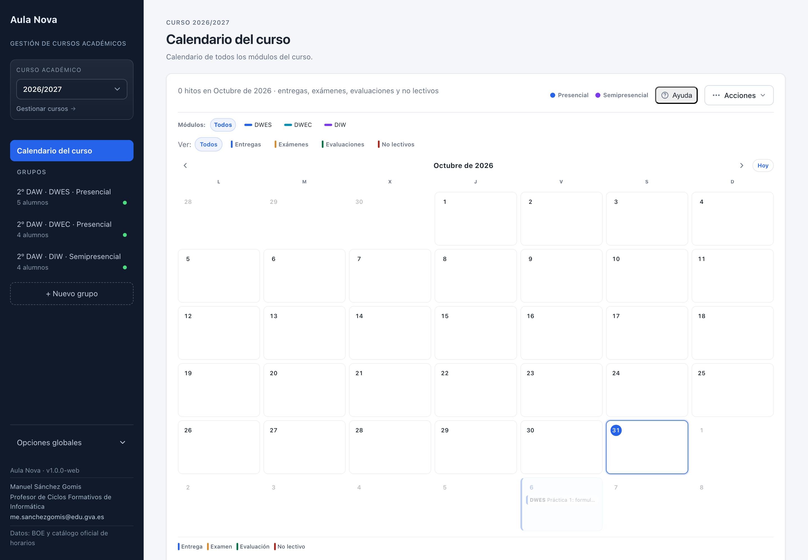
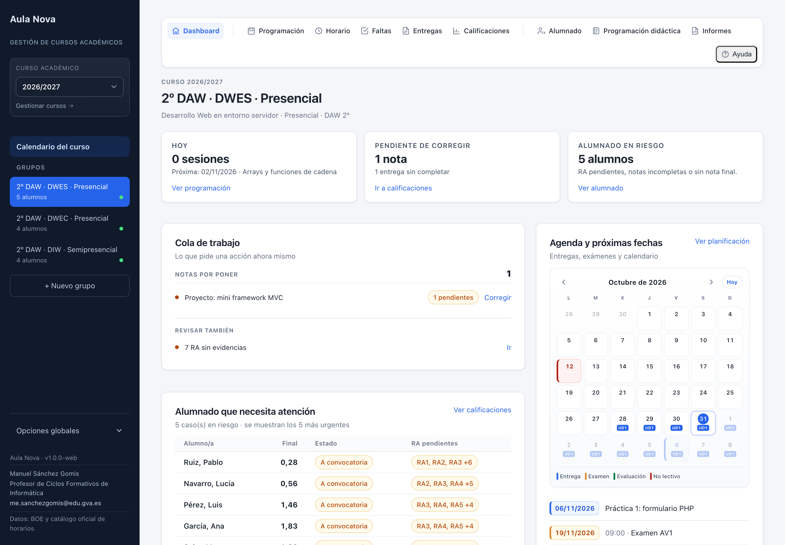
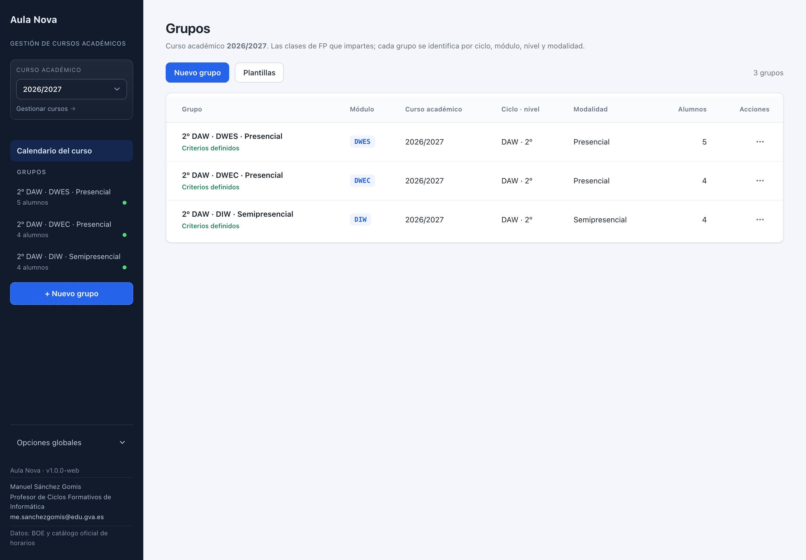
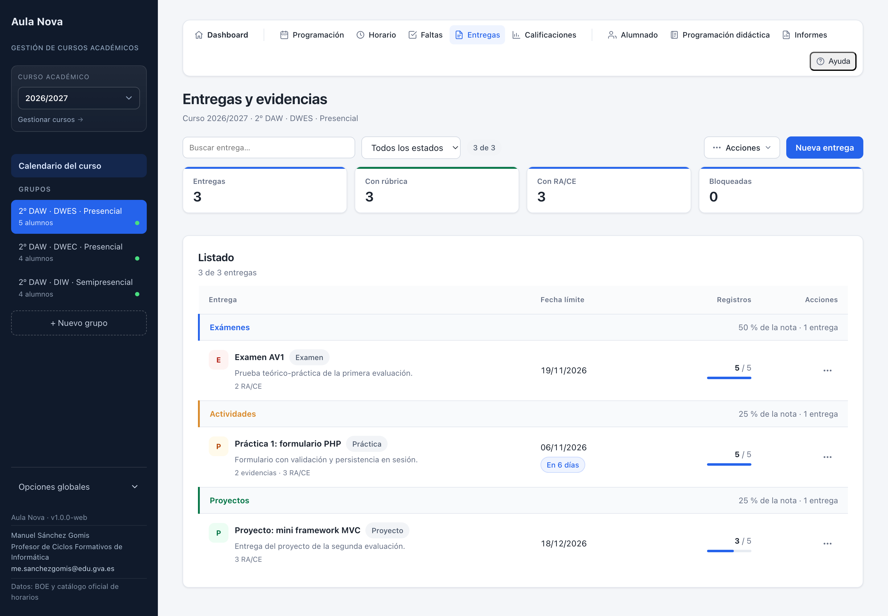
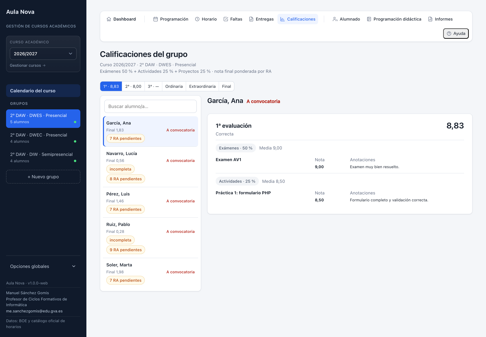
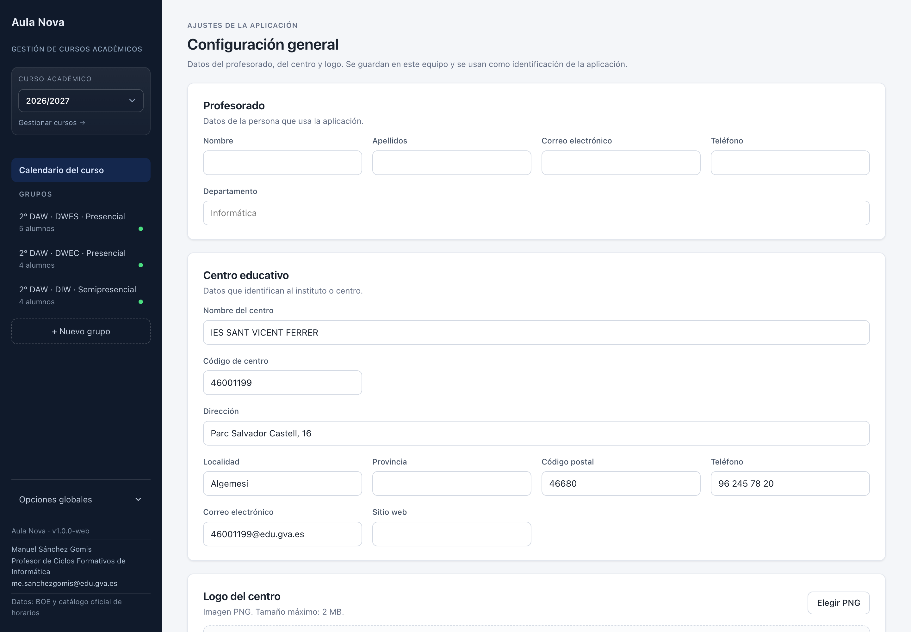

# Aula Nova · gestión de cursos académicos, entregas y calificaciones

Aplicación de escritorio **local** para organizar la docencia de FP alrededor de **grupos de
clase**: programación, alumnado, entregas con rúbrica, evidencias, calificaciones, formación en
empresa e informes trazables al BOE.

> **📘 [Guía visual online](https://msanchez07.github.io/docente-curso/)** — la misma guía que la
> ayuda integrada de la aplicación, con capturas reales de todas las pantallas.
>
> **📄 [Guía de uso en Markdown](./GUIA-APLICACION.md)** — versión de consulta rápida con capturas.

> **Repositorio:** [github.com/msanchez07/docente-curso](https://github.com/msanchez07/docente-curso)
>
> **Autor:** Manuel Sánchez Gomis · Profesor de Ciclos Formativos de Informática
> · [me.sanchezgomis@edu.gva.es](mailto:me.sanchezgomis@edu.gva.es)
>
> El detalle de lo construido, las decisiones y el historial de iteraciones están en
> [`RESUMEN-ITERACIONES.md`](./RESUMEN-ITERACIONES.md). Ese documento es el que debe actualizarse
> al cerrar cada nueva iteración.

## Estado

Aplicación funcional en **versión 1.0**. Verificación actual:

- `npm run typecheck` ✅
- `npm test` ✅ **217 tests**
- `npm run build` ✅
- `npm run smoke` ✅

## Release 1.0

Empaquetado para macOS, Windows y Linux. Los artefactos se generan en `dist/`:

| Plataforma                | Artefacto                              |
| ------------------------- | -------------------------------------- |
| macOS Apple Silicon       | `AulaNova-1.0.0-mac-arm64.dmg`         |
| macOS Intel               | `AulaNova-1.0.0-mac-x64.dmg`           |
| Windows x64               | `AulaNova-1.0.0-win-x64-setup.exe`     |
| Linux x64 (AppImage)      | `AulaNova-1.0.0-linux-x86_64.AppImage` |
| Linux x64 (Debian/Ubuntu) | `aula-nova_1.0.0_amd64.deb`            |

```bash
npm run dist:mac    # DMG + ZIP (arm64 y x64)
npm run dist:win    # instalador NSIS x64
npm run dist:linux  # AppImage + .deb x64
npm run dist:all    # las tres plataformas
```

Las compilaciones de esta release **no están firmadas ni notarizadas**. macOS puede pedir abrir la
aplicación con clic derecho → Abrir; Windows puede mostrar el aviso de SmartScreen. Para
distribución pública conviene configurar certificados de firma.

La release **no carga datos de prueba**: la aplicación arranca vacía y solo incluye los datos
oficiales del BOE y el catálogo de secuenciación y horarios. Los datos de ejemplo quedan
restringidos a la previsualización web de desarrollo.

---

## Capturas

|                                                         |                                                       |
| ------------------------------------------------------- | ----------------------------------------------------- |
|  |        |
| **Calendario del curso**                                | **Dashboard del grupo**                               |
|                 |       |
| **Grupos y cursos**                                     | **Entregas y evidencias**                             |
|          |  |
| **Calificaciones y convocatorias**                      | **Configuración general**                             |

La guía completa, con todas las capturas y explicaciones, está en
**[la guía visual online](https://msanchez07.github.io/docente-curso/)**.

---

## Funcionalidad principal

- **Cursos académicos automáticos** por fecha (septiembre–julio); actualmente `2026/2027`.
- **Grupos** por ciclo, nivel, modalidad y módulo, con nombre generado y curso académico
  asignado automáticamente.
  - Catálogo oficial de **secuenciación y horarios 2026/2027** de Grado Básico, Medio y
    Superior, cargado desde los PDFs de la Conselleria.
  - Buscador de ciclos por nombre, siglas o familia profesional, con filtros por nivel y
    familia.
  - Selector de módulos filtrado por curso, con código, horas semanales y horas anuales.
- **Horario semanal** de bloques de 55 minutos:
  - Mañana 08:00–14:00, recreo 10:45–11:15.
  - Tarde 14:40–21:05, recreo 18:00–18:20.
  - En semipresencial se marcan sesiones, tutorías colectivas y tutorías individuales, con
    varias posibles por día y colores distintos.
  - Vista independiente de horario desde el dashboard.
- **Calendario del curso** como punto de entrada de la aplicación:
  - Calendario único con entregas, exámenes, evaluaciones y no lectivos de todos los módulos.
  - Etiquetas por módulo dentro de cada día, con enlace al dashboard del módulo.
  - Colores automáticos por módulo y leyenda de modalidad presencial/semipresencial.
  - Filtros por módulo y tipo, panel del día seleccionado, impresión/PDF y exportación .ics.
  - Importación del calendario escolar y definición manual de días no lectivos.
  - Sin tablas de alumnado, colas de trabajo ni listados de módulos.
- **Dashboard del grupo** centrado en la acción y el calendario:
  - **Barra superior de navegación de grupo**: Dashboard, Día a día (Programación, Horario,
    Faltas, Entregas, Calificaciones) y Consulta (Alumnado, Programación didáctica, Informes),
    con separadores verticales. Sustituye al botón «Volver» en las vistas de grupo.
  - Resumen de **hoy**, **notas pendientes** y **alumnado en riesgo**.
  - **Cola de trabajo** con entregas por corregir y avisos accionables.
  - Agenda con minicalendario y próximas fechas.
  - Estado del grupo, formación y programación didáctica en un bloque plegable.
  - Días coloreados por entregas, exámenes, evaluaciones y festivos/no lectivos.
  - Festivos y no lectivos con fondo rojo, sin indicar unidad didáctica.
  - Unidades didácticas visibles por día con colores estables.
  - Listado de próximos hitos y fila aparte de días no lectivos.
- **Programación de aula**: sesiones por fecha y hora, varias por día, unidades, desviaciones y
  observaciones. El calendario escolar se gestiona de forma centralizada desde el **Calendario
  del curso**.
- **Programación didáctica**: unidades, fechas, criterios y RA/CE.
  - **Presentación del módulo**: plantilla HTML editable, con datos reales del grupo, vista
    previa, copia para Aules, descarga e impresión/PDF.

- **Entregas**:
  - Asociación obligatoria a una unidad didáctica.
  - Secciones **Enunciado**, **Descripción del problema** y **Restricciones**.
  - Pestañas **Ficha** y **Notas** al abrir una entrega; la ficha es la vista inicial.
  - Ficha HTML autocontenida, con vista previa, copia para Aules, descarga e impresión/PDF.
  - Rúbrica en texto y/o archivo, evidencias y mapeo a RA/CE.
  - Bloqueo/desbloqueo y notas por alumno.
  - Exportación PDF/ZIP por entrega o curso completo, con dossier y archivos cuando corresponde.
  - Los PDF usan la cabecera institucional: datos y logo del centro, logo de Conselleria y logo de la Unión Europea.
  - La impresión de exámenes usa un formato limpio de texto, con instrucciones destacadas y sin criterios de evaluación.
- **Calificaciones**:
  - Vista de consulta: la nota final no se edita aquí, se calcula desde las entregas.
  - Pestañas por evaluación, **Ordinaria**, **Extraordinaria** y **Nota final**.
  - Instrumentos de calificación: categorías y pesos.
  - **Pesos de categorías por trimestre**: cada trimestre puede usar los pesos generales o un
    cálculo propio (por ejemplo, 50 % examen y 50 % proyecto, con actividades a 0 %). El cálculo
    propio afecta a la nota del trimestre; la final sigue ponderándose por RA.
  - **Cada RA tiene su peso en la nota final**; por defecto se reparten a partes iguales entre los RA.
  - La nota final es la media ponderada de las notas de los RA.
  - Informe PDF por alumno y acceso a su informe completo.
  - **Convocatorias ordinaria y extraordinaria** integradas como pestañas, con bloques por
    trimestre, unidad o RA/CE, asignación por alumno, notas y examen personalizado. Solo se crea
    una convocatoria de cada tipo.
- **Informes** de grupo y alumno con gráficas, RA, formación, impresión y exportación.
  - Las descargas **HTML/CSV** se agrupan en el menú **Acciones**; la impresión/PDF queda como
    acción principal.
- **Plantillas de criterios** con listado y edición en páginas propias.
- **Normativa FP** a pantalla completa e importación desde la barra lateral.
- **Datos de prueba** en la previsualización web: restaurar o eliminar.
- **Control de faltas por curso/tutoría**:
  - Contexto de curso compacto; el selector solo aparece cuando hay varios cursos/tutorías.
  - Límite de faltas y cómputo de justificadas en una barra de ajustes compacta, con interruptor.
  - Todos los módulos del curso en tarjetas, con nombre exacto en el informe ITACA, horas y
    límite.
  - Se excluyen los módulos de FCT/formación en empresa, que no tienen faltas.
  - Importación de PDFs de faltas de varias páginas.
  - **Historial plegable** con las faltas extraídas de cada informe; no se guarda el PDF.
  - Tabla por alumno y módulo: número de faltas en caja neutra y porcentaje en píldora de color,
    con primera columna fija y cabecera por código/nombre de módulo.
  - Impresión/PDF del informe seleccionado.
- **Copias de seguridad por grupo**:
  - Carpeta raíz global configurable.
  - Subcarpeta automática por curso académico.
  - JSON autocontenido por grupo (alumnado, criterios, entregas, notas, evidencias,
    programación, unidades con sus plantillas, eventos y formación; archivos en base64).
  - Importación de una copia para restaurar solo ese grupo.
  - Aviso si la carpeta no está configurada o ha desaparecido.
  - Copia automática al abrir la aplicación si el contenido de un grupo cambió.
- **Menú de opciones globales** en la barra lateral (cursos, plantillas, copias, normativa y
  datos de prueba).
- **Configuración general**:
  - Datos del profesorado y del centro educativo, incluido el código de centro.
  - Logo del centro en PNG con vista previa y límite de tamaño.
  - Guardado local, sin servicios externos.
- **Interfaz homogénea**:
  - Menús **Acciones** desplegables con iconos para las operaciones secundarias.
  - Notificaciones emergentes de guardado, error y aviso, en lugar de mensajes perdidos en la
    página.
  - **Guía integrada** con capturas reales en **Opciones globales → Guía de uso** y ayuda
    contextual por sección desde el botón **Ayuda** de la barra superior.

## Stack

- Electron
- Vue 3 + TypeScript + Pinia + Vue Router
- SQLite con `better-sqlite3` y migraciones versionadas (última: **v37**)
- Vite / electron-vite
- Vitest
- JSZip para exportaciones con archivos

## Puesta en marcha

Requisitos: Node.js 20+ y npm.

```bash
npm install
npm run dev        # app de escritorio en desarrollo
npm run dev:web    # previsualización en navegador con API simulada
```

## Comandos

```bash
npm run typecheck  # comprobación de tipos
npm test           # tests unitarios
npm run build      # typecheck + build de main, preload y renderer
npm run smoke      # flujo renderer → preload → IPC → SQLite
npm run smoke:boe  # lectura de los recursos del BOE
npm run horarios:parse  # regenera el catálogo desde los PDFs de la Conselleria
npm run guia:html  # regenera la guía visual en docs/index.html
npm run format     # Prettier
npm run lint       # ESLint
```

Empaquetado:

```bash
npm run build:unpack
npm run build:mac
npm run build:win
npm run build:linux
```

## Estructura

```text
src/
├── main/            # proceso principal: SQLite, IPC, servicios de exportación
│   ├── db/          # esquema, migraciones y repositorios
│   ├── entregas/    # exportación de entregas (PDF/ZIP)
│   ├── informes/    # informes HTML/PDF/CSV
│   └── programacion/# exportación de programación a PDF
├── preload/         # puente tipado entre renderer y main
├── renderer/        # interfaz Vue 3
│   ├── components/  # componentes reutilizables
│   ├── dev/         # API simulada para la previsualización web
│   ├── stores/      # Pinia
│   └── views/       # vistas por grupo y globales
├── shared/          # tipos, validaciones y generadores compartidos
└── resources/       # BOE, normativa y materiales de ejemplo
tests/               # pruebas unitarias
scripts/             # smoke tests y utilidades
```

## Datos y privacidad

La base de datos vive en el equipo del docente:

```text
~/Library/Application Support/gestion-entregas/gestion-entregas.db   # macOS
```

No hay backend remoto. La previsualización web (`npm run dev:web`) es solo una simulación local
con `localStorage`. Las exportaciones se generan localmente.

## Documentación

- [`GUIA-APLICACION.md`](./GUIA-APLICACION.md) — guía completa de uso y mantenimiento.
- [`RESUMEN-ITERACIONES.md`](./RESUMEN-ITERACIONES.md) — estado vivo, decisiones, historial y
  pendientes.
- [`PLAN.md`](./PLAN.md) — plan original por fases.
- [`PLAN-REVISION-SECCIONES.md`](./PLAN-REVISION-SECCIONES.md) — revisión de secciones.
